<p align="center">
  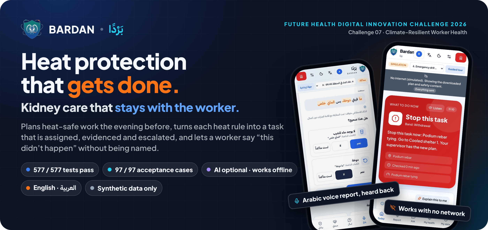
</p>

<p align="center">
  
  
  
  
  
  
  <a href="https://bardan-1049030199952.europe-west1.run.app"></a>
</p>

<p align="center">
  <a href="https://bardan-1049030199952.europe-west1.run.app"><b>Open the live demo</b></a> &nbsp;·&nbsp;
  <a href="../../releases/latest"><b>Watch the walkthrough</b></a> &nbsp;·&nbsp;
  <a href="docs/EVALUATOR-GUIDE.md"><b>Judge it in 10 minutes</b></a> &nbsp;·&nbsp;
  <a href="docs/ONE-PAGE.md"><b>One-page summary</b></a> &nbsp;·&nbsp;
  <a href="#run-it-in-two-minutes"><b>Run it</b></a> &nbsp;·&nbsp;
  <a href="docs/ARCHITECTURE.md"><b>Architecture</b></a> &nbsp;·&nbsp;
  <a href="docs/AI-INTEGRATION.md"><b>How AI is used</b></a>
</p>

---

**Bardan** (Arabic <span dir="rtl">بَرْدًا</span>, *coolness*) is a working prototype for the **Future Health Digital Innovation Challenge 2026,
Challenge 07: Climate-Resilient Worker Health**. Individual entry by **Nipun Dilshan Senevirathne**. It runs end to end
in **English and Arabic**, on a phone or a laptop, with **synthetic data only**.

## 🎬 Project Demo

[](https://www.youtube.com/watch?v=KDHKV4QdAm0)

**▶️ Click the video thumbnail above to watch the idea.**

## Bardan in 30 seconds

- **The problem.** Outdoor workers in the Gulf already have heat rules, forecasts and a midday break. What fails is the
  step after the warning: the water point is empty but the sheet says "done", the shade is full at break time, a new
  worker is pushed too hard in his first days, and an abnormal kidney test never reaches a doctor.
- **What Bardan does.** It plans heat-safe work the evening before, turns every heat rule into a protective task that
  is assigned, evidenced, escalated and independently checked, lets a worker say *"this didn't happen"* without being
  named, and keeps kidney care private and continuous.
- **Try it with your own numbers.** The **Scenario Lab** takes your sample workers, weather and tasks and re-plans in
  about a second: breaks follow the ISO 7243 / NIOSH heat limits for the actual job, every worker's phone updates in
  their language, and a **shift simulator** replays the day as conditions change. An **optional wearable**, off by
  default and controlled by the worker, can only ever add rest.
- **Why you can believe it.** 639 automated tests (all passing) cover all 97 acceptance cases of the specification;
  the forecast was backtested on data it never saw; every AI feature was run live in English and Arabic; and every
  limit is stated, in the app and here.

<p align="center">
  <a href="../../releases/latest">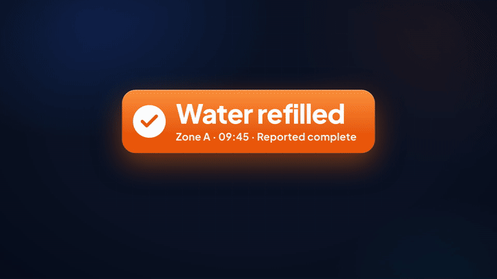</a><br>
  <sub>A badge that lied: “Water refilled”, while the cup was empty. Select it to watch the live walkthrough of the app.</sub>
</p>

## What makes Bardan different

| | The usual way of working | With Bardan |
|---|---|---|
| **After a warning** | An alert, a toolbox talk, a poster | Every rule becomes a **task with an owner, a start-by time and the evidence it needs**; a task nobody accepts escalates on its own |
| **"Done"** | A tick on a checklist | **Verified only with the required evidence tier** (E0 to E4) and no open dispute; a supervisor's tick can never verify "water restored" |
| **The worker's voice** | Raised with the same supervisor who ticked it | **"This didn't happen"** reopens the task and sends it to HSE; the supervisor never sees who; only a fresh, independent check closes it |
| **Planning** | Today's heat index and the midday break | A **72-hour zone forecast** (Liljegren WBGT, backtested) and a **CP-SAT plan** the evening before, re-checked by the rule engine and approved by a named person |
| **Breaks** | One fixed break an hour, or none; often skipped to meet a deadline | **The shortest break that keeps each hour within the ISO 7243 / NIOSH limit for that job**, counting the walk and the rest spot's own heat; cooled rest buys back working time; the cost is shown honestly as working time |
| **Wearables** | A heart-rate dashboard for the employer | **Processed on the worker's phone.** The worker is warned first; the supervisor gets the words "needs a break" only if the worker chose that, never a number; it can only add rest |
| **Kidney health** | A result on paper that may never reach a doctor | A **separate clinical vault** with its own key; the employer sees only "clinic visit 14:00–16:00"; the worker sees who opened the record |
| **AI** | Not used, or a chatbot answering freely | **AI proposes, engines decide, people approve.** A safety router before every model, an 18-check Guardian after it, and every screen works with AI off |
| **Language and network** | Often English only, and online only | **English and Arabic** throughout, read aloud; reports and the emergency alert survive a lost network and a reload |

## Judge it in ten minutes

Open the **[live demo](https://bardan-1049030199952.europe-west1.run.app)**, press **Open the judge sandbox**, choose a persona, then **Guided tour** → **Start the guided tour**: it takes you through nine steps as each person, rings the control to use next and says what it does, while you do the clicking. Each
judge gets a private sandbox that resets after an hour. The full walkthrough, in English and Arabic, is in
[docs/EVALUATOR-GUIDE.md](docs/EVALUATOR-GUIDE.md).

| Judging criterion | What to try | Where the proof is |
|---|---|---|
| **Real-world health value** | As **Joseph** (supervisor): *Tomorrow's plan* → *Evaluate draft* → *Optimise with Bardan*. Heavy work leaves the harshest hours, breaks fit the 20 shaded seats, new workers stay within acclimatization, and every change has a reason. Then open the **Scenario Lab** and enter your own workers, weather and tasks. | [Problem and loop](#how-it-works), [Scenario Lab](#try-your-own-scenario) |
| **Technical design** | Scene 3 as **Ravi**: the live reading beats the forecast and his card changes at once. *Trust Centre → Decision replay*: the phone's and the server's engines agree on 49 of 49 cases. | [docs/ARCHITECTURE.md](docs/ARCHITECTURE.md) |
| **Working solution** | As **Anwar**, say or type <span dir="rtl">«ما فيني دوخة، بس الماي خلص»</span> and check the words heard. Then the water task: Joseph reports it done, Ravi presses *This didn't happen*, Sara checks it herself and resolves it. In the Scenario Lab, press *Play the shift*, make it hotter and cut the water: the plan and every phone change from that minute. | [Screens](#see-it-working), [the dispute story](docs/ARCHITECTURE.md#the-dispute-story) |
| **Responsible AI and data governance** | *Sandbox controls* → *Red-team test mode*, then ask <span dir="rtl">«هل كليتي تفشل؟»</span>: the unsafe draft is blocked. Turn AI off and simulate no internet, then press *Emergency*. As Joseph, try to open a clinical record. As **Ravi**, *My data* → turn on the optional wearable and see what reaches the supervisor: three words, by choice. | [docs/AI-INTEGRATION.md](docs/AI-INTEGRATION.md), [privacy](#privacy-by-design), [wearable](#a-wearable-the-worker-controls) |
| **Scale and deployment** | *Trust Centre → AI evaluation*: the planner solves 200 workers in well under a second. One container on Cloud Run, free tier. | [docs/LOAD-TEST.md](docs/LOAD-TEST.md), [docs/DEPLOY-CLOUD-RUN.md](docs/DEPLOY-CLOUD-RUN.md) |
| **Commercial viability and route to pilot** | *Trust Centre → Release tests*: all 97 acceptance cases with the tests behind them. *Drills*: run a timed, observed drill with three phones. In the Scenario Lab, read the working time a protected day costs, next to the usual fixed day that breaks the limit. | [docs/PILOT-KIT.md](docs/PILOT-KIT.md), [docs/DRILL-PROTOCOL.md](docs/DRILL-PROTOCOL.md) |

**Personas:** Ravi Kumar (new worker, English) · Anwar Hussain (worker in the kidney pathway, Arabic) · Joseph Mathew
(supervisor) · Sara Al Mansoori (HSE lead, Arabic) · Dr Fatima Al Hashimi (clinician, Arabic) · Mariam Haddad (site
nurse) · Guest reviewer (independent observer). All fictional.

## See it working

Real screens from the prototype, captured as it runs on the synthetic site.

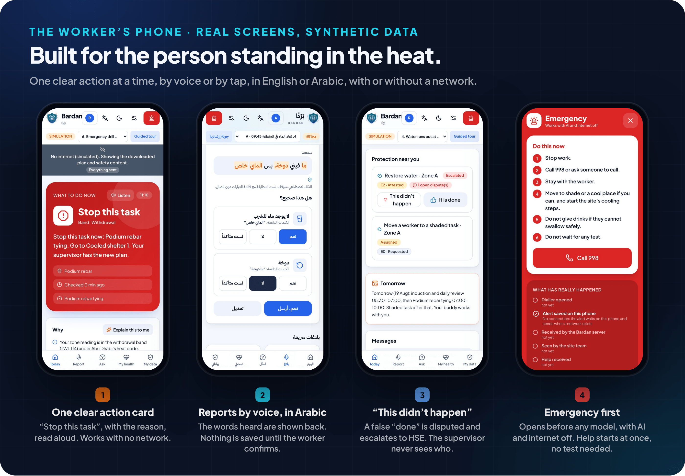


## The problem

![The heat rules and warnings exist; the step after the warning is what fails. Already in place: heat rules and the midday break, forecasts and warnings, supervisor checklists, clinics. Where it breaks: an empty water point marked done, full shade at break time, a new worker pushed too hard, an abnormal kidney test that never reaches a doctor. What Bardan adds: planning the evening before, rules as tasks with owners and proof, "this didn't happen" without being named, private and continuous kidney care.](docs/diagrams/problem-gap.png)

## How it works

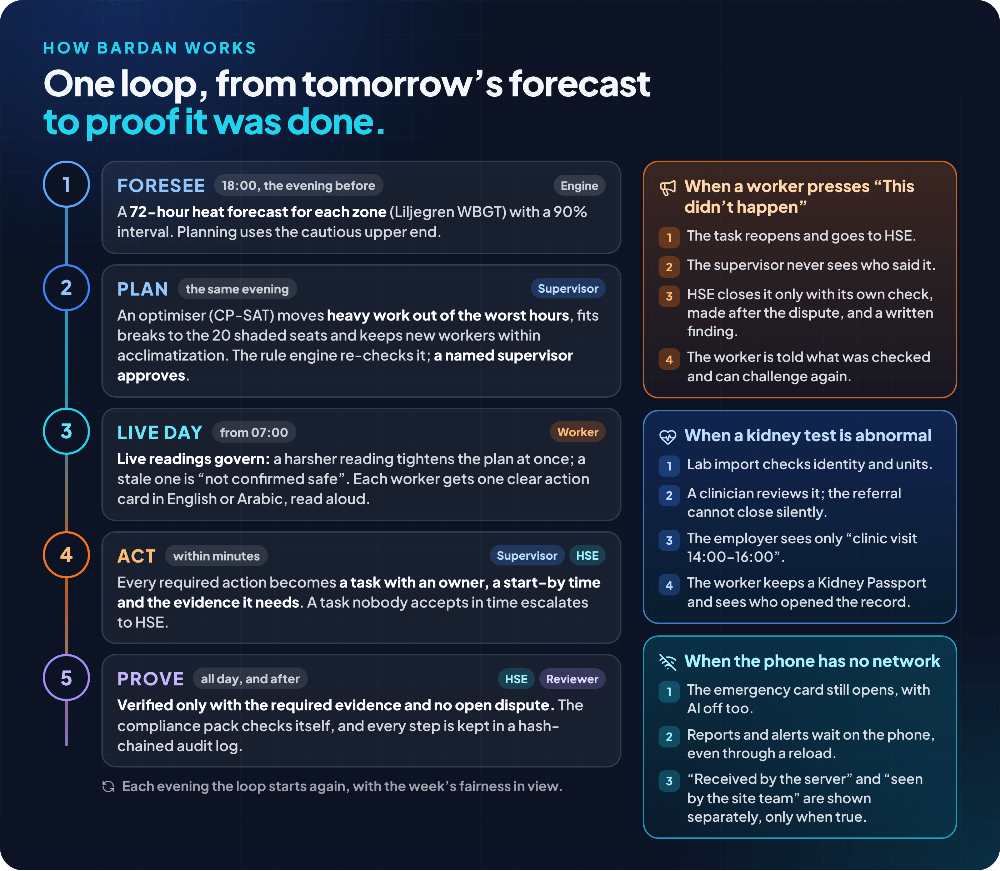

The demonstration day plays the whole loop on a fictional 40-worker site in Abu Dhabi, with weather replayed from
19 August 2025. Each scene is one click in the app's scene picker.

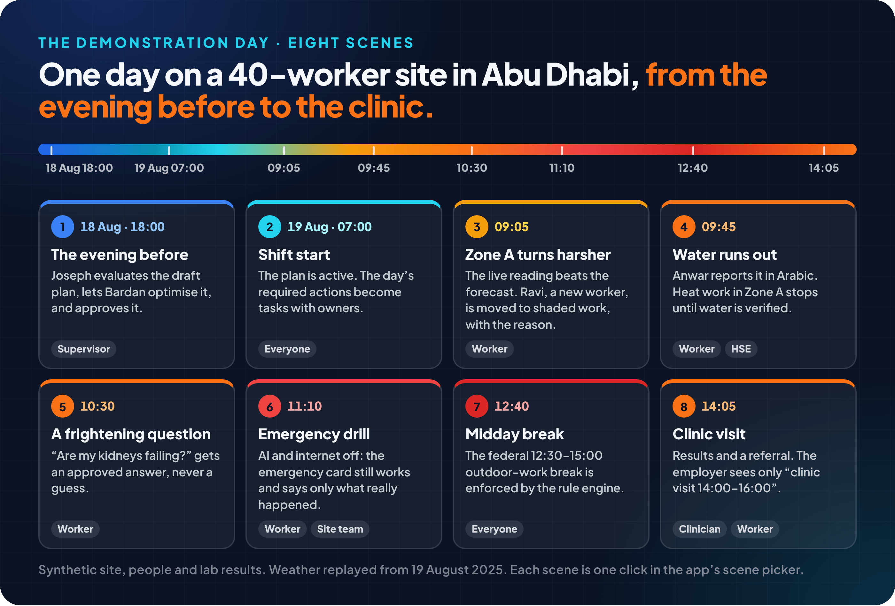

## Try your own scenario

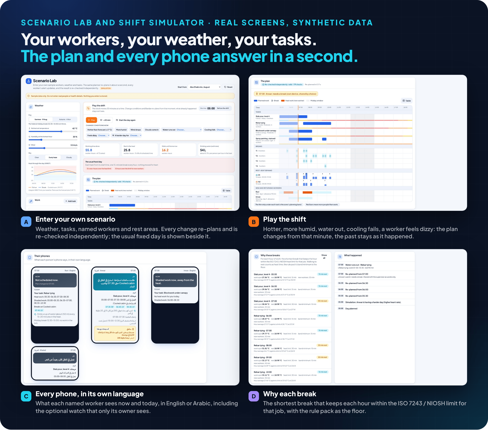

Open **Scenario Lab** as Joseph, Sara or the Guest reviewer. Start from one of three presets (Abu Dhabi in August, a
humid coastal day in September, a mild day in November) and change anything: the hottest air temperature, humidity,
wind and sky; each task's place (full sun, part shade, under a canopy, indoors), how hard it is, the working hours it
needs, the clothing, when it may run, whether it must be done in one go and whether part may wait; the named workers
to follow (phone language, new or returning and which day, a clinician's label, a simulated watch); and the rest areas
(cooled or shade only, seats). Nothing typed into the Lab is stored. On each change, in about a second on one CPU:

1. **Weather to heat.** Liljegren WBGT for full sun, shade, a still indoor space and a cooled room, from your weather
   and a clear-sky sun model. Plans use the value plus 0.82 °C, the upper end of the 90% band, as for the site forecast.
2. **Break planner.** For every crew and hour, the shortest break, in 15-minute steps, that keeps the hour within the
   one-hour limit for that job: 56.7 − 11.5·log₁₀M for acclimatized workers and 59.9 − 14.1·log₁₀M for workers who are
   not (ISO 7243:2017; NIOSH REL and RAL; the ACGIH TLV and Action Limit), with the walk to the rest area counted as
   heat time and the ACGIH clothing adjustment. The rule pack's band minimum, the withdrawal band and the federal midday
   break stay the floor. A new or returning worker whose crew's breaks would not be enough does shaded work for part
   of that hour instead (Hong Kong's 2026 guidance gives such workers 15 more minutes of rest an hour).
3. **Plan.** CP-SAT decides when each crew works and rests, counting working time net of breaks, sharing rest seats
   per 15 minutes and keeping new workers inside their acclimatization allowance. It never relaxes a rule to fit the
   work in: when no protected plan exists it names the permitted options (let part wait, add seats or shaded places),
   and you choose.
4. **Independent re-check.** The rule engine re-checks every worker and slot, and every worked hour is re-checked
   against the heat limit as planned. A plan is only ever shown as valid if it passed.
5. **Phones.** What each named worker's phone says, in English or Arabic: what to do now, today's heat work and
   breaks, water, and the midday break.

**Play the shift** moves the clock in 30-minute steps. Make it hotter, more humid or still, bring in clouds, cut the
water at a task, fail the cooling in a rest area, or have a worker feel dizzy: Bardan re-plans from that moment, what
already happened stays as it happened, and the log says what moved and why.

The **usual fixed day** (each task from its start time, one 15-minute break an hour) is checked against the same
limits beside the plan. In the August preset it goes over the heat limit for 12 crew-hours and for 12 hours of new
workers' time; on the mild November day the same site needs no extra rest and nothing waits, so protection is not a
fixed penalty. Hong Kong already publishes hourly work–rest schedules by type of work; a construction union reported
that the longest breaks did not happen on site because of deadlines. Bardan puts the breaks into the plan and shows
what they cost in working time, so they are planned for instead of skipped.

## A wearable the worker controls

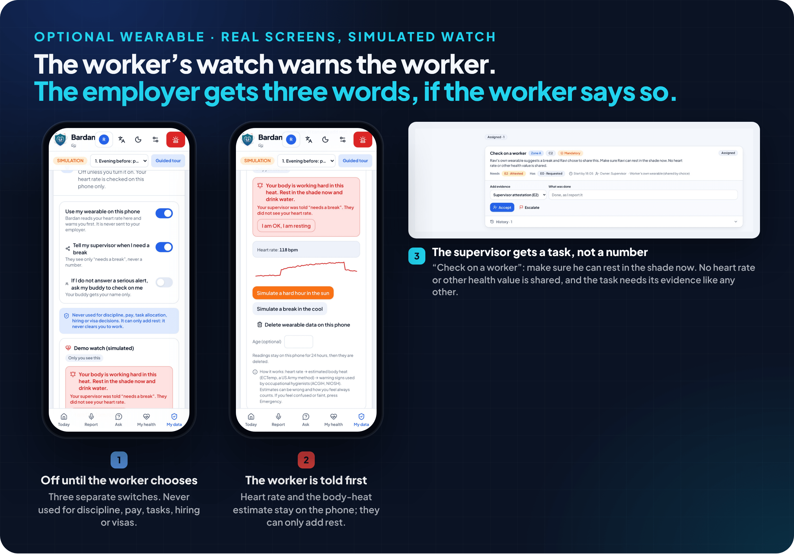

- **Off by default.** The worker turns it on, on their own phone, with three separate choices: use it; tell my
  supervisor when I need a break; ask my buddy to check on me if I do not answer a serious alert.
- **Processed on the phone.** Heart rate becomes an estimate of body heat with ECTemp (Buller and colleagues, US Army
  Research Institute of Environmental Medicine, 2013: 95% of estimates within ±0.63 °C in the laboratory, ±1.2 °C in an
  independent field check), then the ACGIH warning signs are checked: a heart rate above 180 minus age for five
  minutes, above 120 one minute after stopping, or an estimate of 38.5 °C (38.0 °C for a worker not yet acclimatized).
- **The worker is told first.** The supervisor gets a *Check on a worker* task with the words "needs a break" only if
  the worker chose that. The server refuses any number, and has no status that could clear a worker.
- **It can only add rest.** Such estimates raise many false alarms (AIHA, 2024), so a reading never shortens a break,
  never lifts a stop and never marks anyone fit, and no reading changes nothing. The rule pack already forbids
  inferring fitness from pulse.
- **Never used** for discipline, pay, task allocation, hiring or visa decisions. Readings stay on the phone for 24
  hours, and one tap deletes them.
- In the Scenario Lab, give Anwar's simulated watch a harder day: it asks for a break, the planner receives only
  "needs a break", and only Anwar rests.

The heart rate here is simulated; no device is connected yet. Methods, thresholds and sources are in
[docs/ARCHITECTURE.md](docs/ARCHITECTURE.md#scenario-lab-break-planner-and-the-optional-wearable) and
[docs/RULE-REVIEW.md](docs/RULE-REVIEW.md).

## How AI is integrated

**Bardan Intelligence proposes and explains. Deterministic engines decide. Named people approve.** No model can decide
an emergency, relax a limit, diagnose, score a worker or act without the named person's approval, and every screen
works with AI switched off. The full design, with every safeguard and where it lives in the code, is in
[docs/AI-INTEGRATION.md](docs/AI-INTEGRATION.md).

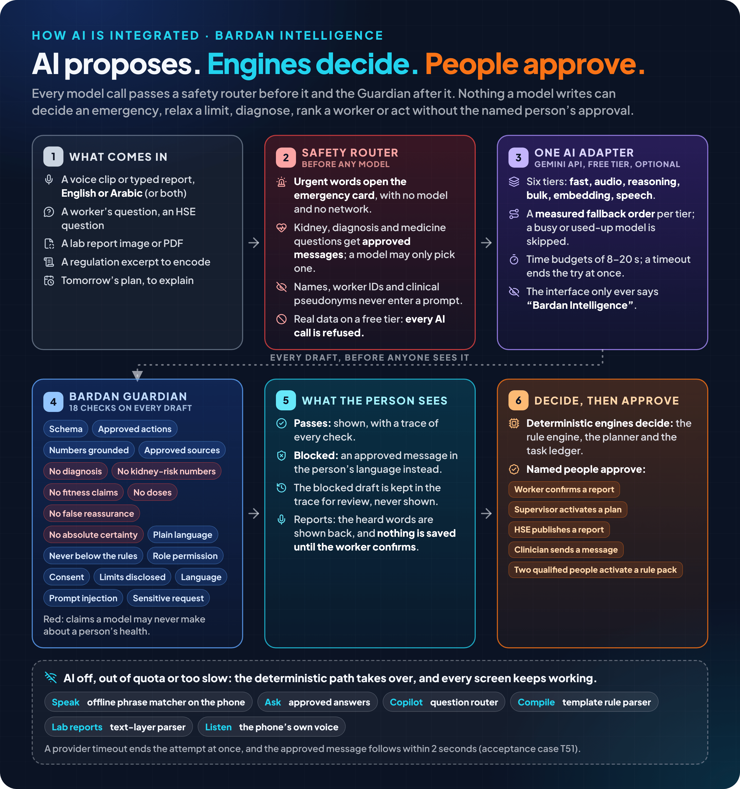

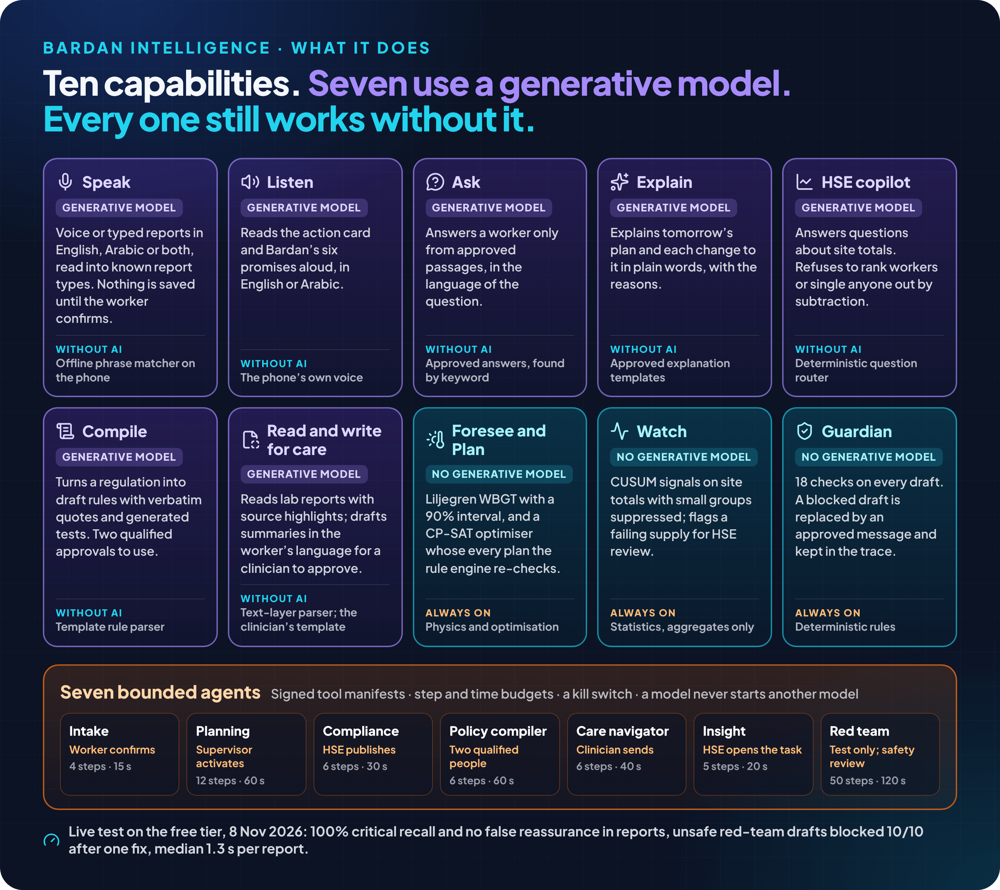

- **Before any model:** urgent words open the emergency card with no model and no network; kidney, diagnosis and
  medicine questions get approved messages; names, worker IDs and clinical pseudonyms never enter a prompt; real data
  on a free tier is refused outright.
- **After every model:** the Guardian (`backend/app/ai/gate.py`) checks schema, approved actions, numeric grounding,
  approved sources, six forbidden health claims, plain language, the policy floor, role permission, consent,
  disclosed limits, language, prompt injection and sensitive requests. A blocked draft is replaced by an approved
  message and kept in the trace for review.
- **Measured live** on the free tier in English, Arabic and mixed speech (8 November 2026): 100% critical recall and
  no false reassurance over 44 reports; unsafe red-team drafts blocked 10 of 10 after one fix; median 1.3 s per
  report. What the live test found, and how each finding became a regression test, is in
  [docs/AI-MODELS.md](docs/AI-MODELS.md).
- **The interface only ever says "Bardan Intelligence".** Models, quotas and the fallback order are documented in
  [docs/AI-MODELS.md](docs/AI-MODELS.md) and nowhere in the product; a release test fails if a model name reaches
  any page.

## Proof, not paperwork

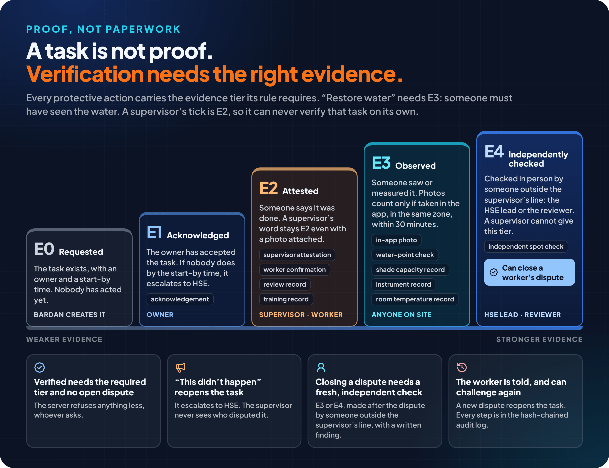

The task ledger is a small state machine with rules the server enforces for every role. It is drawn in full in
[docs/ARCHITECTURE.md](docs/ARCHITECTURE.md#the-protection-ledger).

## Privacy by design

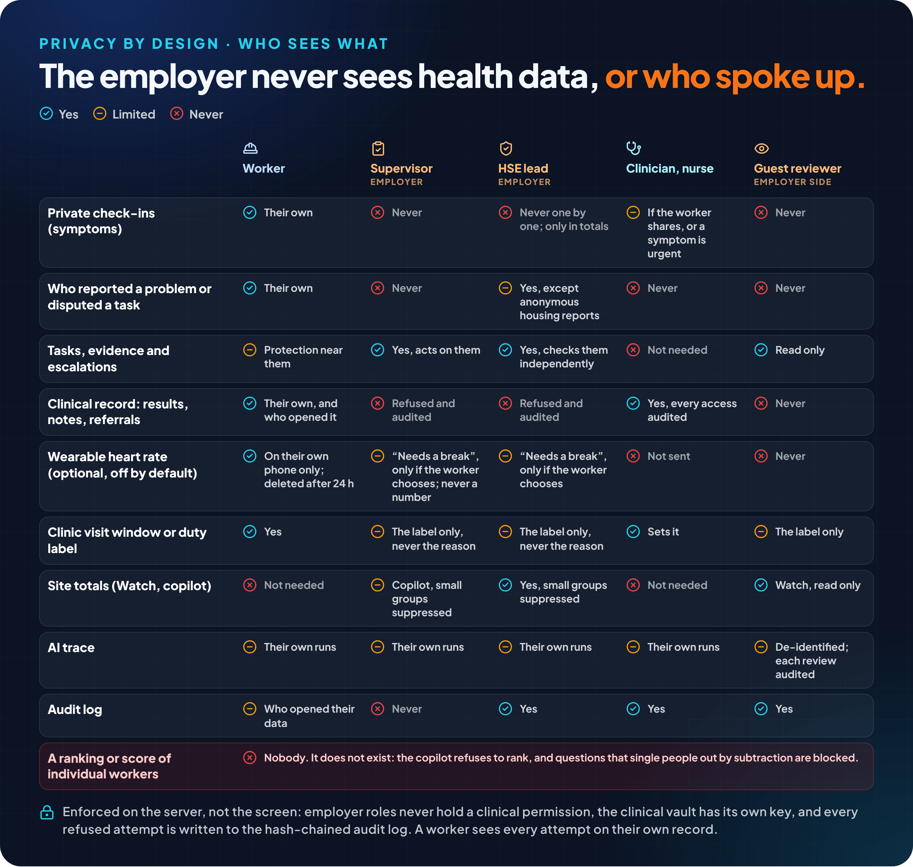

## Architecture

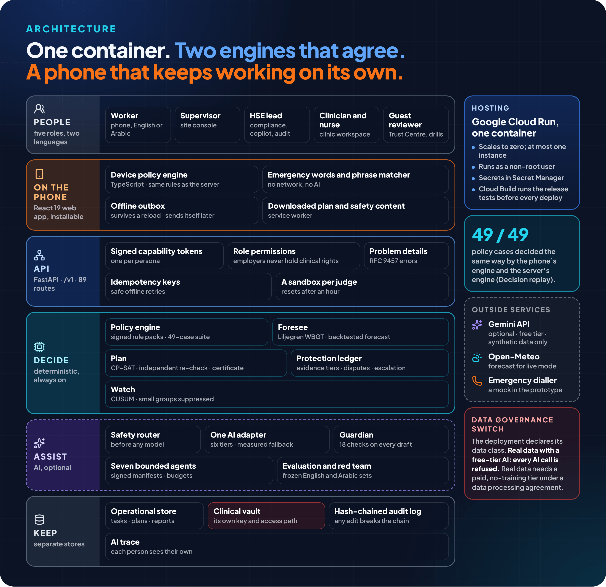

| Layer | Built with |
|---|---|
| Phone and consoles | React 19, TypeScript, Vite, Tailwind CSS, TanStack Query, Recharts, an installable web app with an offline service worker (Workbox) |
| Device engine | The heat rules and the emergency phrase matcher in TypeScript, so the phone decides alone when offline |
| API | Python 3.13, FastAPI (89 routes), signed capability tokens, RFC 9457 problem details, idempotency keys |
| Decisions | Policy engine with signed rule packs; Liljegren WBGT ([thermofeel](https://github.com/ecmwf/thermofeel)); Google OR-Tools CP-SAT; a protection ledger; CUSUM signals |
| AI (optional) | One adapter for the Gemini API free tier, the Bardan Guardian, seven bounded agents |
| Hosting | One Docker container on Google Cloud Run (scales to zero, at most one instance), Secret Manager, Cloud Build |

Components, data flow, invariants and ten detailed diagrams are in [docs/ARCHITECTURE.md](docs/ARCHITECTURE.md); every
diagram, with its source, is in [docs/diagrams](docs/diagrams/README.md).

## Evidence


| What | Result | How it was measured |
|---|---|---|
| Release tests | **639 of 639 pass** (486 server, 153 device) | Every build; each of the 97 acceptance cases names the tests that check it. [docs/TESTING.md](docs/TESTING.md) |
| Scenario Lab | Every plan shown passed the independent re-check across **1,722** simulated half-hour steps (120 random days, four seeds) | Random weather, tasks, workers and mid-shift changes; a seeded 64-step version runs in every build. [docs/TESTING.md](docs/TESTING.md) |
| Decision replay | **49 of 49** identical | The phone's TypeScript engine and the server's Python engine on the shared conformance suite |
| Forecast backtest | **89.1%** coverage of the 90% interval; mean error **0.76 °C** (persistence 0.84, climatology 0.90) | Fitted, calibrated and tested on three separate periods of 2025, 2,340 held-out zone-hours, only data available at the 18:00 issue time; replayed weather, not site instruments |
| Live AI, 8 Nov 2026 | **100%** critical recall, **0** false reassurance, red team **10 / 10**, **1.3 s** median | Free tier, English, Arabic and mixed, in a browser against the hosting container. [docs/AI-MODELS.md](docs/AI-MODELS.md), raw results in [docs/evidence](docs/evidence/live-ai-2026-11-08.json) |
| Load | **270** requests a second for 50 judges (95th percentile under 45 ms); **100** judges in the same second, **0** errors | One CPU core. [docs/LOAD-TEST.md](docs/LOAD-TEST.md) |
| Offline | Reports and the emergency alert wait on the phone, survive a reload and send themselves | A real loss of network in a browser rehearsal. [e2e/offline_phone.py](e2e/offline_phone.py) |
| Workflows | **7 of 7** scripted situations behave as designed | Run through the real code each time the report is built; behaviour, not speed |
| Watch | **93%** of sudden supply failures caught within 2 days; 0.18 false alerts per site per month | Synthetic history; a slow rise from a low baseline often cannot be caught, and the app says so |

## Run it in two minutes

**Live:** [bardan-1049030199952.europe-west1.run.app](https://bardan-1049030199952.europe-west1.run.app), one container on Google Cloud Run (Belgium) with Bardan Intelligence on. It scales to zero when idle, so the first page after a quiet spell can take a few seconds.

**Locally** (Python 3.12+ and Node 22+):

```bash
make setup      # creates .venv and installs the server and web app dependencies
make run        # builds the web app and serves everything on http://127.0.0.1:8080
make test       # device engine (vitest) and server (pytest): 639 tests
make report     # the release test report shown in the Trust Centre
```

For development, run `make dev-api` and `make dev-web` (hot reload on :5173).

**In a container:**

```bash
docker build -t bardan:local . && docker run --rm -p 8080:8080 -e BARDAN_TOKEN_SECRET=local-dev-secret bardan:local
```

**On Google Cloud Run (free tier):** `PROJECT_ID=your-project ./deploy/deploy.sh`, or the step-by-step guide in
[docs/DEPLOY-CLOUD-RUN.md](docs/DEPLOY-CLOUD-RUN.md) (secrets, budget alert, continuous delivery).

AI is optional. Set `GEMINI_API_KEY` (in Secret Manager on Cloud Run) to switch Bardan Intelligence on. Without it the
app runs on approved templates and the deterministic engines, and every screen still works.

## Repository map

```text
bardan/
├── backend/            FastAPI server (Python)
│   ├── app/core/       policy engine, task ledger, consent, clinical vault, audit log, sandbox
│   ├── app/planner/    Site Heat Twin, CP-SAT optimiser, independent re-check, fairness, break planner, Scenario Lab
│   ├── app/forecast/   Liljegren WBGT, replay forecast and backtest, live Open-Meteo mode
│   ├── app/ai/         AI adapter, Guardian, Speak, Ask, copilot, compiler, agents, evaluation
│   ├── app/insights/   Watch: CUSUM signals with small-group suppression
│   ├── app/api/        the /v1 routes: worker, operations, clinic, Trust Centre, drills
│   ├── tests/          486 release tests, tied to the acceptance cases
│   └── scripts/        load test, live AI benchmark, drill publishing, lexicon parity
├── frontend/           React web app: worker, site console, Scenario Lab, clinic, Trust Centre, drill console
│   └── src/engine/     the device policy engine, offline phrase matcher and wearable engine, with 153 tests
├── shared/             rule packs, the 49-case conformance suite, the emergency lexicon
├── e2e/                browser rehearsals: guided tour, lost network, drill, live AI, Scenario Lab and wearable
├── deploy/             deploy.sh (Cloud Run from source) and cloudbuild.yaml (test, build, deploy)
├── docs/               guides, evidence, diagrams (docs/diagrams), screenshots (docs/images)
├── .github/            continuous integration, issue and pull request templates
├── Dockerfile          one container: builds the web app, runs the API as a non-root user
└── Makefile            setup, run, test, report, docker, deploy
```

## Status, limits and the road to a pilot

This is a competition prototype, and it says so everywhere. The site, people, instruments, lab results and history are
synthetic; the weather is replayed from 2025. The heat rules carry a **Demo heat rules** label until a qualified
reviewer checks them against the current Abu Dhabi guideline ([docs/RULE-REVIEW.md](docs/RULE-REVIEW.md)). The
emergency dialler and all outgoing messages are mocks. The Scenario Lab's break planner uses published reference
values (ISO 7243, NIOSH, ACGIH) that await the same qualified review, and the wearable's heart rate is simulated: no
device is connected. **No drill has been observed, no qualified person has reviewed the rules, and there is no
clinical partner, customer, approval or pilot yet.**

What a pilot needs, and what is already prepared for it ([docs/PILOT-KIT.md](docs/PILOT-KIT.md)):

1. **A qualified review** of the heat rules and an occupational clinician's review (sheets and forms ready).
2. **Comprehension testing** of the worker screens in English and Arabic (protocol ready).
3. **Observed drills** on a real site, timed from failure to independently verified restoration (console and
   protocol ready: [docs/DRILL-PROTOCOL.md](docs/DRILL-PROTOCOL.md)).
4. **Hosting inside the UAE** with PostgreSQL and a separate clinical database, a paid no-training AI tier under a
   data processing agreement, and the Department of Health ADHICS application.
5. **Integrations** for push or SMS, HR rosters and laboratory results.

The full design, including all 97 acceptance cases, is in [docs/finalsystem.md](docs/finalsystem.md).

## Documentation

| Document | What it covers |
|---|---|
| [ONE-PAGE.md](docs/ONE-PAGE.md) | What is implemented, simulated and planned, on one page |
| [EVALUATOR-GUIDE.md](docs/EVALUATOR-GUIDE.md) | A ten-minute walkthrough for judges, in English and Arabic |
| [ARCHITECTURE.md](docs/ARCHITECTURE.md) | Components, data flow, the ledger, privacy, offline, deployment, with diagrams |
| [AI-INTEGRATION.md](docs/AI-INTEGRATION.md) | How AI is used, guarded, measured and switched off |
| [AI-MODELS.md](docs/AI-MODELS.md) | Models, quotas, the fallback order, and what the live tests found |
| [TESTING.md](docs/TESTING.md) | Release tests, findings, live tests and the AI evaluation |
| [DEPLOY-CLOUD-RUN.md](docs/DEPLOY-CLOUD-RUN.md) | Deploying on Google Cloud Run within the free tier |
| [LOAD-TEST.md](docs/LOAD-TEST.md) | How the load test was run, and its results |
| [DRILL-PROTOCOL.md](docs/DRILL-PROTOCOL.md) | Observed drills: method, safety rules and the tamper-checked export |
| [RULE-REVIEW.md](docs/RULE-REVIEW.md) | The heat rules compared with the current guideline, for a qualified reviewer |
| [PILOT-KIT.md](docs/PILOT-KIT.md) | Market, UAE hosting and health-data law, outreach and review forms |
| [diagrams/README.md](docs/diagrams/README.md) | Every diagram, with its source and how to redraw it |
| [images/README.md](docs/images/README.md) | Every screenshot, full size |
| [LICENSES-AND-CREDITS.md](docs/LICENSES-AND-CREDITS.md) | Every library, data source and asset, with its licence |
| [finalsystem.md](docs/finalsystem.md) | The full specification, with the 97 acceptance cases in Appendix D |

## نبذة بالعربية

<div dir="rtl">

**بَرْدًا: حماية من الحرارة تُنجَز فعلاً، ورعاية للكلى تبقى مع العامل.**

يخطط بَرْدًا للعمل الآمن من الحرارة في المساء السابق، ويحوّل كل قاعدة من قواعد الحرارة إلى مهمة لها مسؤول وموعد
بدء ودليل مطلوب، وتُصعَّد المهمة تلقائياً إذا لم يقبلها أحد في موعدها. ويستطيع العامل أن يقول «هذا لم يحدث» دون أن
يُكشف اسمه للمشرف، ولا يُغلق الاعتراض إلا بتحقق مستقل جديد. وتبقى نتائج فحوص الكلى في سجل طبي منفصل، فلا يرى صاحب
العمل إلا «زيارة عيادة 14:00–16:00».

وفي **مختبر السيناريوهات** يُدخل المقيّم عماله وطقسه ومهامه التجريبية، فيعيد بَرْدًا التخطيط في نحو ثانية: تُحسب
الاستراحات وفق حدود ISO 7243 وNIOSH لنوع العمل الفعلي، ويتحدث هاتف كل عامل بلغته، ويمكن تشغيل الوردية وتغيير الظروف
أثناءها. والساعة الذكية اختيارية وغير مفعلة افتراضياً، وتُعالج بياناتها على هاتف العامل وحده، ولا يصل المشرف إلا
«يحتاج إلى استراحة» إذا اختار العامل ذلك، ولا يمكنها إلا زيادة الراحة.

الواجهة كاملة بالعربية والإنجليزية، وبطاقة الطوارئ تعمل دون إنترنت ودون ذكاء اصطناعي. يعمل النموذج الأولي ببيانات
اصطناعية فقط. للتجربة خطوة بخطوة، راجع القسم العربي في [دليل المقيّمين](docs/EVALUATOR-GUIDE.md).

</div>

## Author, credits and licence

Designed and built by **Nipun Dilshan Senevirathne** as an individual entry. Weather replayed from
[NASA POWER](https://power.larc.nasa.gov/); live forecasts from [Open-Meteo](https://open-meteo.com/); WBGT by
[thermofeel](https://github.com/ecmwf/thermofeel); scheduling by [Google OR-Tools](https://developers.google.com/optimization);
icons by [Lucide](https://lucide.dev). Every library, data source and asset is listed with its licence in
[docs/LICENSES-AND-CREDITS.md](docs/LICENSES-AND-CREDITS.md).

No open-source licence has been chosen for Bardan's own code yet, so all rights are reserved by the author. Third-party
components keep their own licences.

<sub>All people, places, records and results in this repository are fictional or synthetic. The emergency dialler is a
mock and never contacts emergency services.</sub>
