# Bardan architecture

How the prototype is built, how a decision is made, and which rule is enforced where. Every claim below points to the
code or the release test that holds it. For the judge's view, start with the [README](../README.md); for the AI in
depth, see [AI-INTEGRATION.md](AI-INTEGRATION.md).

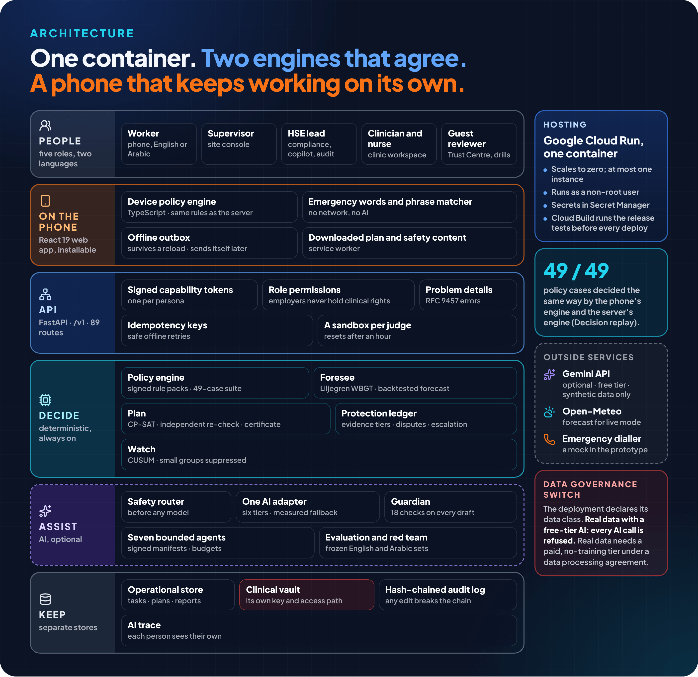

**Contents:** [Design principles](#design-principles) · [Components](#components) ·
[How a heat decision is made](#how-a-heat-decision-is-made) · [Foresee and Plan](#foresee-and-plan) ·
[The protection ledger](#the-protection-ledger) · [A worker's report](#a-workers-report) ·
[The dispute story](#the-dispute-story) · [Emergency and offline](#emergency-and-offline) ·
[Privacy and access](#privacy-and-access) · [Bardan Intelligence](#bardan-intelligence) ·
[Deployment](#deployment) · [Invariants and the tests that hold them](#invariants-and-the-tests-that-hold-them)

## Design principles

1. **Live values govern.** A forecast plans ahead but is never treated as a live reading; a harsher live reading
   tightens the plan at once, and a stale one is "not confirmed safe".
2. **The optimiser is never trusted.** Every plan is re-checked by the rule engine on a separate code path and approved
   by a named person; activation is refused if anything changed since evaluation.
3. **A task is not proof.** Nothing is verified without the evidence tier its rule requires and with a dispute open.
4. **No retaliation signal.** The supervisor never learns who disputed a task or reported a missing protection.
5. **Clinical separation.** Employer roles hold no clinical permission at all; they see a visit window or a duty label,
   never a reason.
6. **AI proposes, engines decide, people approve.** And every screen works with AI off.
7. **Emergency first.** Urgent words open the emergency card before any model, with no network, and the screen never
   claims more than really happened.
8. **Honest about itself.** Synthetic data, demo rules and mocks are labelled where they appear.

## Components

| Path | Responsibility | Key files |
|---|---|---|
| `frontend/src/pages` | Worker phone, site console, Scenario Lab, HSE, clinic, Trust Centre, drill console | `worker/Today.tsx`, `worker/Report.tsx`, `site/Plan.tsx`, `site/Tasks.tsx`, `lab/Lab.tsx`, `trust/TrustCentre.tsx` |
| `frontend/src/engine` | The device policy engine, the offline phrase matcher and the wearable engine (TypeScript), with 153 tests | `engine.ts`, `lexicon.ts`, `strain.ts`, `conformance.test.ts` |
| `backend/app/api` | The `/v1` routes (89), capability tokens, problem details, idempotency | `routes_worker.py`, `routes_ops.py`, `routes_clinical.py`, `routes_trust.py` |
| `backend/app/core` | Policy engine, protection ledger, consent, clinical vault, audit log, sandbox and scenario | `policy.py`, `ledger.py`, `consent.py`, `clinical.py`, `audit.py`, `access.py` |
| `backend/app/forecast` | Liljegren WBGT, the replay forecast and its backtest, live Open-Meteo mode | `wbgt.py`, `model.py`, `service.py` |
| `backend/app/planner` | Site Heat Twin, CP-SAT optimiser, independent re-validation and certificate, weekly fairness, break planner, Scenario Lab and shift simulator | `twin.py`, `optimiser.py`, `certificate.py`, `fairness.py`, `workrest.py`, `lab.py` |
| `backend/app/ai` | AI adapter, Guardian, Speak, Ask, copilot, compiler, document AI, agents, evaluation | `gemini.py`, `gate.py`, `intake.py`, `chat.py`, `copilot.py`, `orchestrator.py` |
| `backend/app/insights` | Watch: Poisson CUSUM on aggregated signals with small-group suppression | `cusum.py` |
| `shared` | One source of truth for both engines: rule packs, the 49-case conformance suite, the emergency lexicon | `packs/`, `conformance.json`, `lexicon.json` |

**State.** Each judge gets a private sandbox, held in memory and reset after an hour (a drill sandbox in use lives up
to four hours). That is why Cloud Run runs a single instance; a pilot would move the operational store to PostgreSQL
and the clinical vault to a separate database ([PILOT-KIT.md](PILOT-KIT.md)).

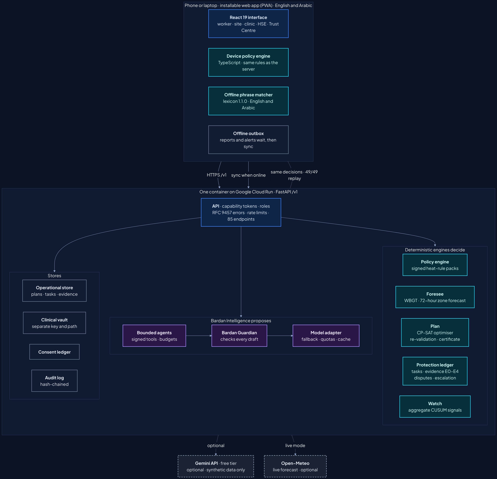

Source: [diagrams/src/01-architecture.mmd](diagrams/src/01-architecture.mmd)

## How a heat decision is made

The policy engine (`backend/app/core/policy.py`) is a pure function: zone reading, its age, the worker's
acclimatization day, the site clock and the active rule packs go in; a protection state and the required actions come
out. The phone runs the same rules in TypeScript (`frontend/src/engine/engine.ts`), so a worker gets a decision with no
network.

- **Rule packs** (`shared/packs`) encode the Abu Dhabi heat code and the federal midday break as data. Each pack's
  canonical JSON is pinned by SHA-256 in `shared/packs/manifest.json` with a review-by date. A modified, rolled-back or
  expired pack is refused, and the engine falls back to "assessment unavailable" and the site's fallback plan. New
  rules come from the policy compiler as drafts that need two qualified approvals; two emirates are never merged into
  one pack.
- **Precedence.** An emergency outranks everything, including the midday window and stale data. The midday window
  uses site time, never device time, and only an authorised exemption record lifts it.
- **Freshness.** A reading older than the pack allows is not "safe": the state becomes "not confirmed safe".
- **Two engines, one answer.** `shared/conformance.json` holds 49 cases that both engines must decide identically.
  *Trust Centre → Decision replay* runs both live and compares them by meaning; the release tests run them on every
  build.

## Foresee and Plan

**Foresee** (`backend/app/forecast`) produces a 72-hour forecast per zone. WBGT is derived with the Liljegren method
(thermofeel). In live mode, hourly weather comes from Open-Meteo. In replay mode (the demonstration), the forecast
"issued the evening before" comes from an explainable model (damped persistence of the latest anomaly towards a
14-day hourly climatology) fitted, calibrated and tested on three separate periods of the 2025 season, using only
readings complete at the 18:00 issue time. Its split-conformal 90% interval covered 89.1% of 2,340 held-out
zone-hours; mean error 0.76 °C against 0.84 °C for persistence. **Planning uses the upper end of the interval**, the
cautious side for heat, and a forecast can only add protection.

**Plan** (`backend/app/planner`) simulates the site-day on a 30-minute grid (the Site Heat Twin) and solves a crew
schedule with Google OR-Tools CP-SAT:

| Hard constraints (never traded for cost) | Objectives, in strict order |
|---|---|
| No outdoor work in the forecast withdrawal band; no direct-sun work in the federal midday window | 1. Fewest heavy-work worker-slots in the buffer band |
| Every heat-work hour in acclimatization or buffer has a shaded break | 2. Least deferred work (deferrable tasks only) |
| Rest seats per 15-minute block never exceed real capacity (walking time counts as exposure) | 3. Fairness: the smallest largest crew share of harsh slots |
| New workers: no heat work in buffer or harsher, minutes within the acclimatization schedule, induction before 07:00 | 4. Least disruption to the supervisor's draft |
| Pours stay contiguous; required work is done unless marked deferrable | 5. Acclimatization progress in safe bands |

If no protected plan exists, the result says so, names the binding constraints and tests the permitted remedies. The
result is only a proposal: `certificate.py` re-checks it worker by worker and slot by slot with the policy engine on a
code path that shares nothing with the solver (an injected fault is caught, test T75), and checks rest capacity. A
named supervisor approves it, and activation is refused if anything changed between evaluation and activation.

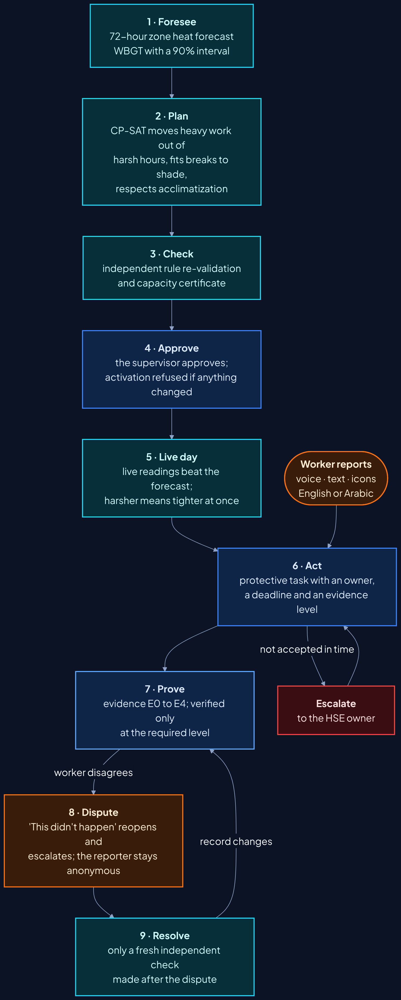

Source: [diagrams/src/02-protection-loop.mmd](diagrams/src/02-protection-loop.mmd)

## Scenario Lab, break planner and the optional wearable

Added after the programme's feedback (17 November 2026): let reviewers enter their own sample workers, weather and
tasks and watch the plan and alerts respond; add a break planner or shift simulator; and, optionally, wearable data
that the worker controls. Nothing here uses AI.

**Break planner** (`backend/app/planner/workrest.py`). The demonstration pack sets a minimum rest per hour by heat band
only. The published method also makes rest depend on the work itself. ISO 7243:2017, the NIOSH 2016 criteria (REL and
RAL) and the ACGIH TLV and Action Limit share two one-hour limits: WBGT ≤ 56.7 − 11.5·log₁₀M for acclimatized workers
and ≤ 59.9 − 14.1·log₁₀M for workers who are not, with M the hour's time-weighted metabolic rate (light 180 W,
moderate 300 W, heavy 415 W, rest 115 W; valid 115–520 W). For each crew and hour the planner finds the shortest break,
in 15-minute steps, that keeps the hour's average WBGT within the limit for the hour's average metabolic rate. The walk
to and from the rest area is spent at the work spot's heat and at walking pace (300 W), so a distant rest area costs
more rest; the ACGIH clothing adjustment is added (coveralls +1 °C, double layer +3 °C). The pack's band minimum is
the floor, so the planner can only add rest. With the same WBGT at work and rest and no walk, the results match the
ACGIH screening table (tested).

**Lab** (`backend/app/planner/lab.py`, `POST /v1/lab/plan`, stateless). The reviewer's weather becomes hourly air
temperature (a diurnal curve to the chosen peak), humidity at a constant dew point, wind and sun (a clear-sky model
scaled for haze or cloud), then Liljegren WBGT per slot for full sun, shade, a still indoor space and a cooled room;
plans use the value plus 0.82 °C (the upper end of the 90% band). Each task becomes a work spot and a crew in the site
plan's world format, so the same policy engine, Site Heat Twin and re-check apply. The CP-SAT model differs from the
site plan's in two ways: working time is counted net of breaks (a task needs its working hours, not slots), and a
crew's break in an hour is one block of the length the break planner asks for. New and returning workers do heat
work only where the lower limit allows, and shaded work for the rest of such hours, inside their acclimatization
allowance; clinician labels and the midday window are hard constraints, as on the site. Objectives, in order: least
heavy work in harsh bands, least work waiting for tomorrow, least rest needed (cooler hours first), fairness, least
disruption (and, when re-planning, least change to the plan already announced), acclimatization progress.

The re-check (`lab.revalidate`) runs the site plan's rule-engine re-check worker by worker and slot by slot, then
re-checks every worked crew-hour against the limit with the working and rest minutes as planned, every new worker's
hour on that worker's own heat time, water outages and personal events. It never reads the solver's model.

**Shift simulator.** The browser sends the scenario, the time, the plan in force and the changes reported so far.
Slots before "now" are fixed to what happened; changes apply only from the slot they were reported in; a crew that
stops at the half hour takes its break straight away. When no protected plan exists, the response names the permitted
remedies (let part wait, add rest seats, add shaded places) and never relaxes the midday window, the withdrawal band,
the heat limit or a clinician's label. The browser keeps the change and waits for the reviewer's decision.

**Optional wearable** (`frontend/src/engine/strain.ts`, `WearableCard.tsx`, `POST /v1/worker/wearable/status`). Off by
default. On the phone, minute heart rate drives ECTemp, the extended Kalman filter of Buller et al. (2013) with the
published parameters (a = 1, γ = 0.022, HR = −4.5714·CT² + 384.4286·CT − 7887.1, σ = 18.88; start 37.1 °C, variance 0).
The warning signs are ACGIH's: heart rate above 180 minus age for five minutes (only if the worker entered an age, kept
on the phone), above 120 one minute after work stops, and an estimate of 38.5 °C, or 38.0 °C for a worker not yet
acclimatized; 38.0 °C alone is "rising" for acclimatized workers. A serious alert goes to the worker first and stays
until answered. Only with the worker's consent (`wearable_status_share`) does the phone send the words
`needs_break`; the server refuses any other field and any other status, creates a *Check on a worker* task (E2, five
minutes) and tells the worker what was shared. A second consent (`wearable_buddy_alert`) lets the phone ask the buddy
to check on the worker, by name only, when a serious alert is not answered. Withdrawal wins, as for every consent.
Readings stay on the phone for 24 hours. In the Lab the same engine runs on simulated heart rates for named workers
with a watch; the planner receives only "needs a break" and gives that worker a 30-minute shaded break.

Why it can only add rest: ECTemp's 95% limits of agreement were ±0.63 °C in the laboratory and ±1.2 °C in an
independent field check, and the AIHA's 2024 review shows a 38 °C decision point catches strain but raises many false
alarms. A false alarm costs a break; a false all-clear could cost a life, so no reading can shorten a break, lift a stop
or mark anyone fit, and no reading means no change. The rule pack already sets `may_infer_fitness_from_pulse: false`.

## The protection ledger

Every required action becomes a task in the ledger (`backend/app/core/ledger.py`): an action code, a zone, an owner, a
start-by time, the evidence tier its rule requires, and a history. The ledger is a state machine; the server refuses
any transition that is not drawn here, for every role.

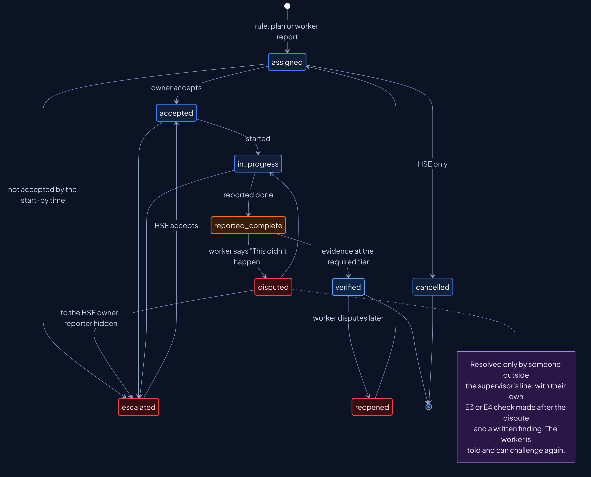

Source: [diagrams/src/03-task-lifecycle.mmd](diagrams/src/03-task-lifecycle.mmd)

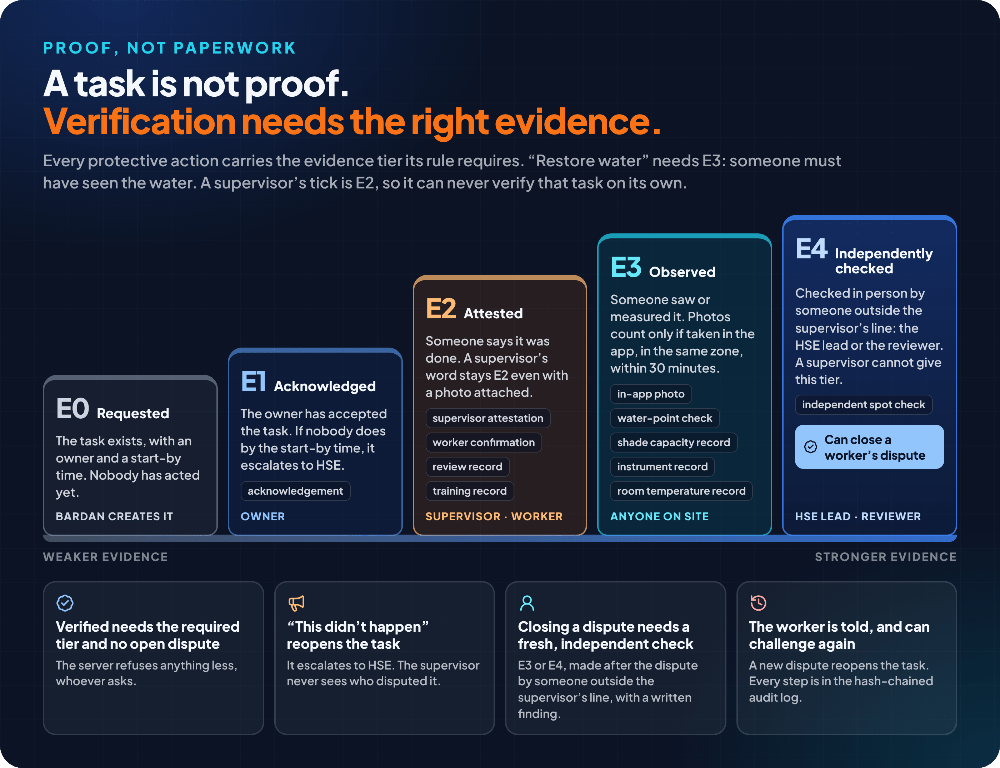

The rules the ledger enforces:

- **Escalation.** A task not accepted by its start-by time escalates to its HSE owner on the next tick, in real time.
- **Evidence tiers.** E0 Requested, E1 Acknowledged, E2 Attested (supervisor attestation, worker confirmation, review or
  training record), E3 Observed (in-app photo, water-point check, capacity, instrument or room-temperature record),
  E4 Independently checked (spot check by HSE or the reviewer). A supervisor's attestation stays E2 even with a photo;
  a photo counts only if taken in the app, in the same zone, within 30 minutes; each evidence kind must fit the action.
- **Verification** needs the required tier and no open dispute. "Restore water" needs E3, so a supervisor's tick alone
  can never verify it.
- **Disputes.** A worker can dispute only a protection they are shown. The task is disputed, then escalated to HSE.
  Only someone outside the supervisor's line can resolve it, with their own E3 or E4 check made after the dispute and a
  written finding of at least eight characters; the person who fixed it cannot also be its independent check. The
  worker is told what was checked and can dispute again; a verified task reopens.
- **No retaliation signal.** `Ledger.public()` removes who disputed and who reported from every view except HSE's, and
  HSE never sees the reporter of an anonymous housing report.
- **Honest rates.** Delivery and verification times are kept separate, a break cut short is not counted as delivered,
  and a completion rate that merges tiers fails validation.

## A worker's report

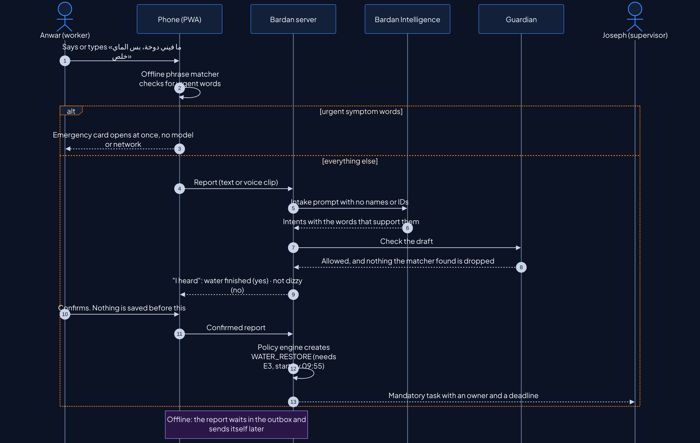

Source: [diagrams/src/05-worker-report.mmd](diagrams/src/05-worker-report.mmd)

Speak reads a voice clip or text in English, Arabic or both into a closed set of report types, each with the words
that support it and its polarity ("not dizzy" is a negation). The phone's offline matcher and the server's matcher share
one lexicon (`shared/lexicon.json`) and are held to the same results by a parity file. Nothing the matcher finds is
dropped by a model; the worker confirms before anything is saved.

## The dispute story

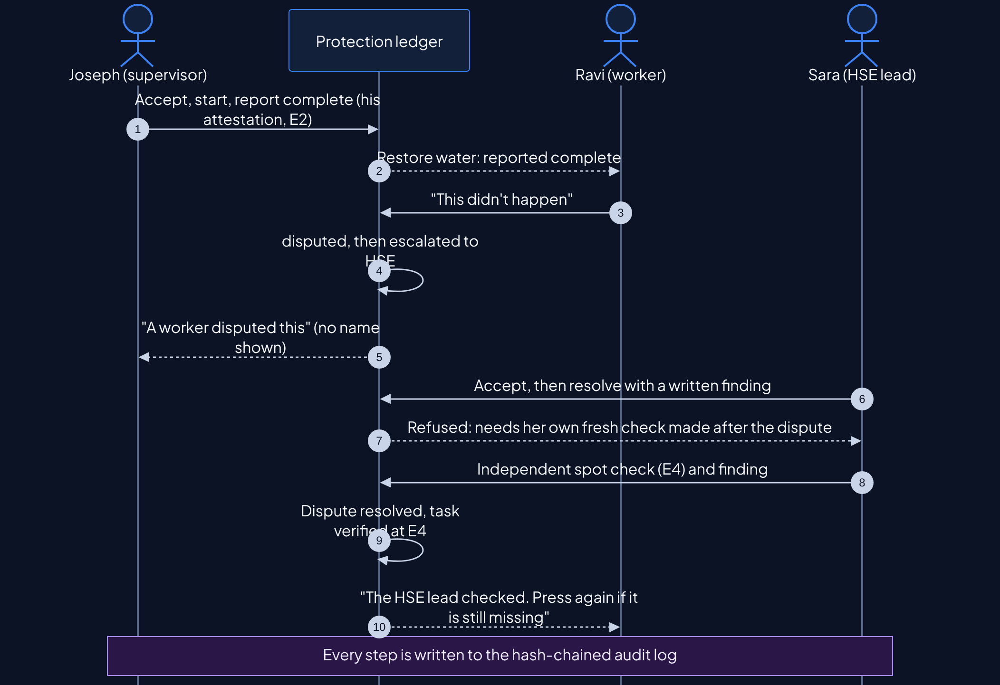

Source: [diagrams/src/06-dispute-story.mmd](diagrams/src/06-dispute-story.mmd)

## Emergency and offline

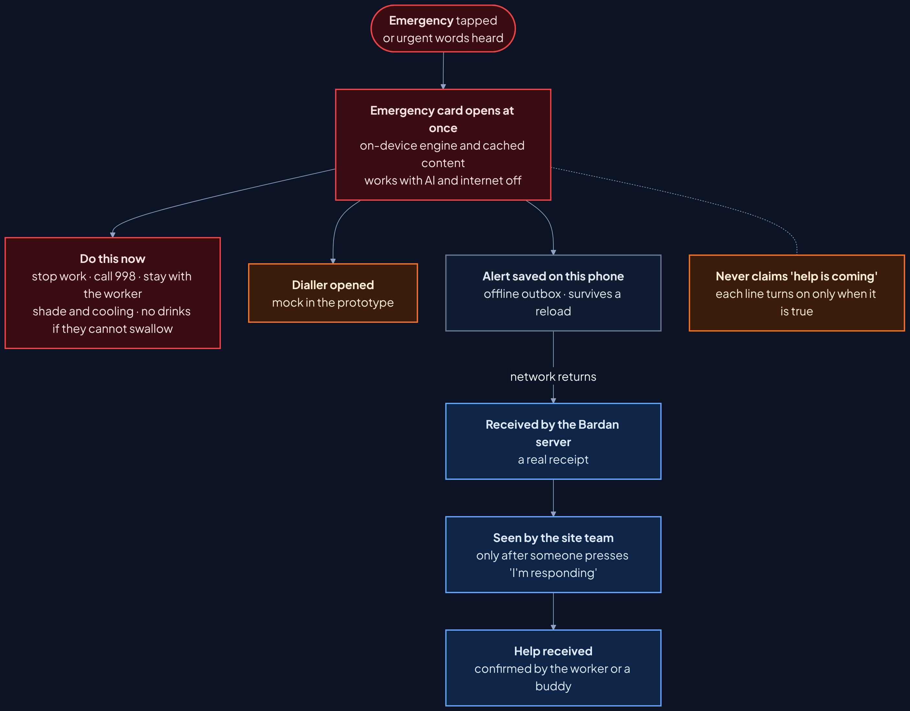

Source: [diagrams/src/07-emergency-offline.mmd](diagrams/src/07-emergency-offline.mmd)

- Urgent words (English and Arabic, including verb forms such as «يتشنج») open the emergency card on the phone before
  any model, with no language model and no network. New confusion is an emergency even with normal readings; heavy
  sweating never cancels one; a fasting preference never changes the instructions.
- The dialler is a mock, and the screen says "dialler opened", never "help called". It separates *alert saved on this
  phone*, *received by the Bardan server* (a real receipt) and *seen by the site team* (only after a responder presses
  *I'm responding*).
- The web app installs on a phone. Its service worker keeps the app shell, the downloaded plan and the safety content;
  reports and alerts wait in an outbox that survives a reload and sends itself when the network returns, with
  idempotency keys so nothing is recorded twice. This was rehearsed with a real loss of network
  ([e2e/offline_phone.py](../e2e/offline_phone.py)).

## Privacy and access

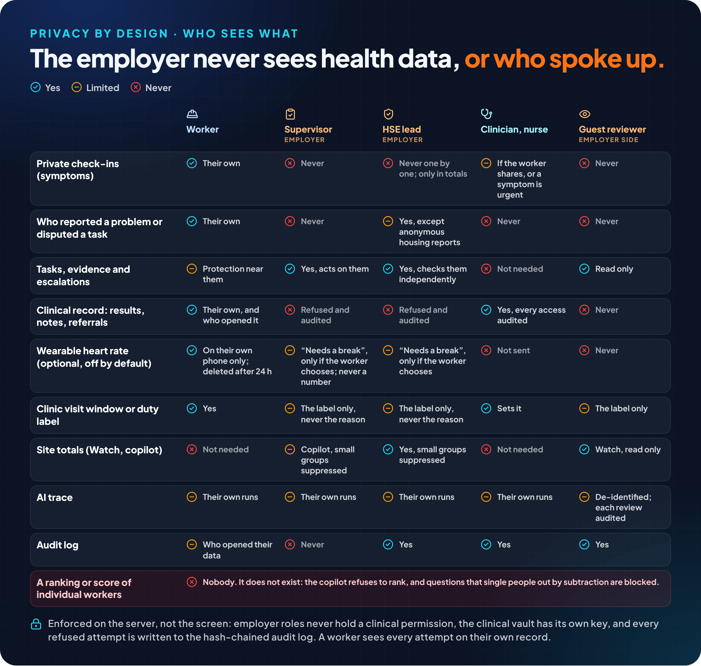

- **Capability tokens.** Choosing a persona issues a signed, expiring token naming the role; every route checks a
  capability from `PERMISSIONS` in `backend/app/core/access.py`. Employer roles (supervisor, HSE, reviewer) hold no
  `clinical.*` capability, so a clinical route refuses them on the server and writes the attempt to the audit log, where
  the worker sees it under *Who saw my data*.
- **Clinical vault.** Results, notes and referrals live in a separate store with its own key (`BARDAN_CLINICAL_KEY`). The
  only clinical-derived data operations can read is a projection: "clinic visit 14:00–16:00" or a duty label such as
  "shaded light duty until 16:00", never the reason, the slot or the urgency. A missed appointment's reason never
  reaches the employer.
- **Consent.** Sharing check-ins with the nurse, care summaries by link and research use are separate, revocable
  consents. Withdrawal wins ties, and a stale offline grant can never restore a withdrawn permission.
- **Aggregates only.** Watch and the copilot work on totals; groups under five and their complements are suppressed,
  questions that isolate people by subtraction are blocked, and nothing ranks workers.
- **Audit log.** Append-only and hash-chained (`backend/app/core/audit.py`); any edit breaks the chain, and
  `GET /v1/audit/verify` checks it.

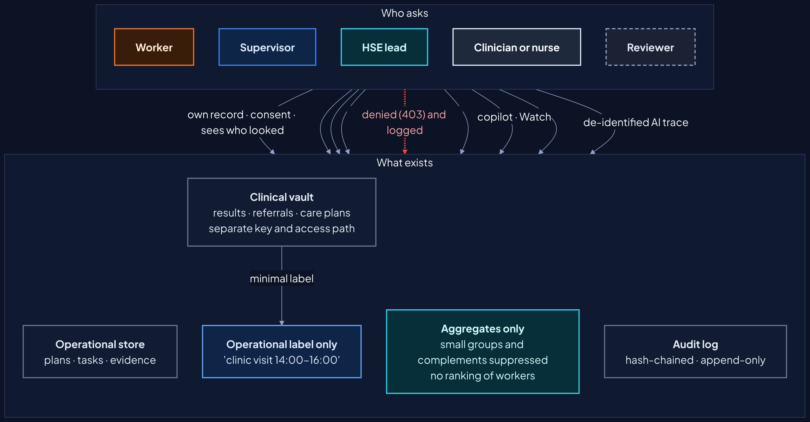

Source: [diagrams/src/08-privacy.mmd](diagrams/src/08-privacy.mmd)

## Bardan Intelligence

AI is an optional layer on top of the engines, never inside them. One adapter makes every model call, a safety router
runs before it and the Guardian after it, and seven bounded agents run with signed tool manifests and budgets. The full
design is in [AI-INTEGRATION.md](AI-INTEGRATION.md); models and quotas are in [AI-MODELS.md](AI-MODELS.md).

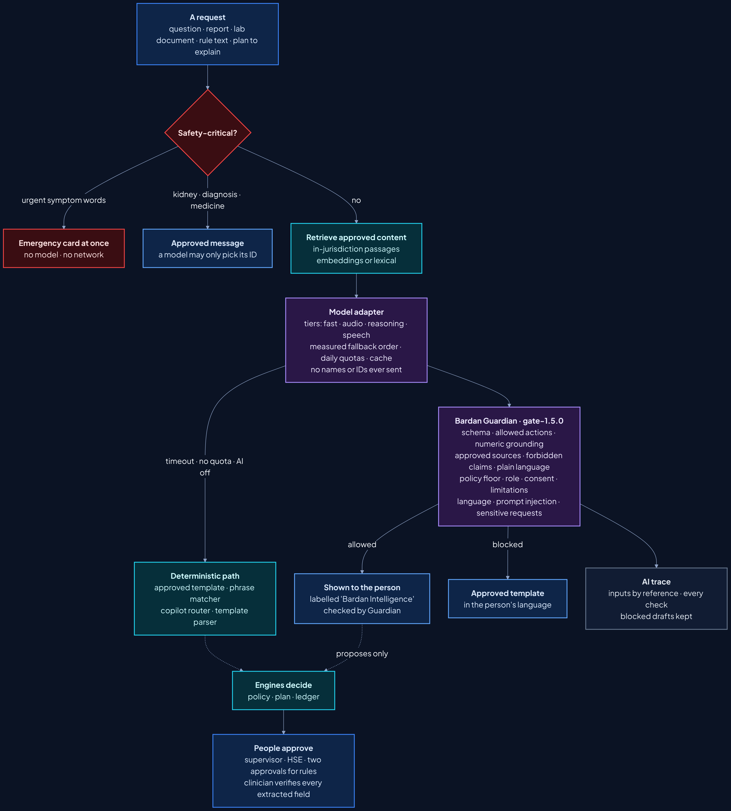

Source: [diagrams/src/04-ai-pipeline.mmd](diagrams/src/04-ai-pipeline.mmd)

## Deployment

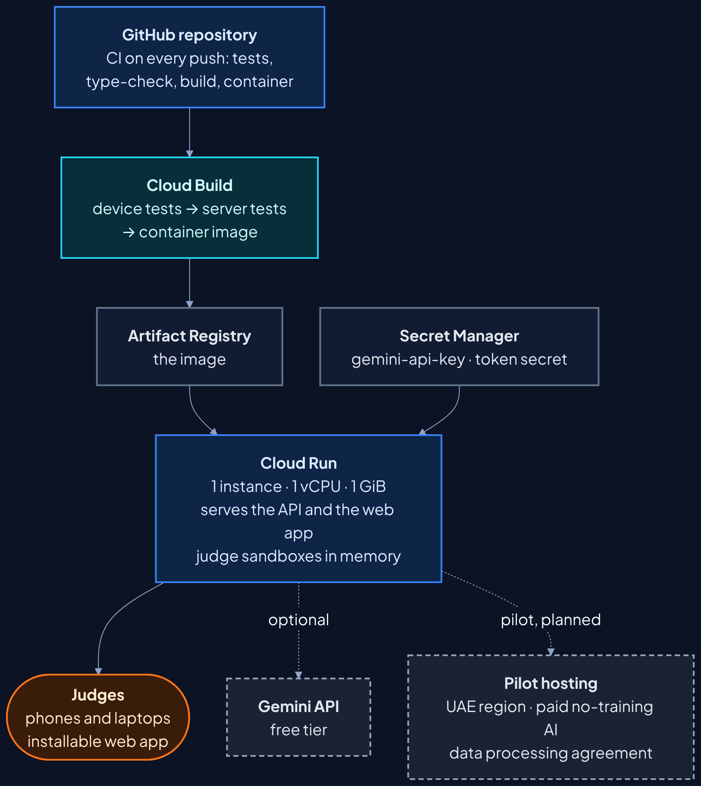

Source: [diagrams/src/09-deployment.mmd](diagrams/src/09-deployment.mmd)

- **One container** (`Dockerfile`): Node builds the web app; a slim Python image serves the API and the app as a
  non-root user. Settings: `--min-instances 0 --max-instances 1 --concurrency 80 --cpu 1 --memory 1Gi`, inside the
  Cloud Run free tier.
- **Secrets** in Secret Manager: the token-signing secret and, optionally, the Gemini key. Without the key the app
  deploys with AI off.
- **Delivery.** `deploy/cloudbuild.yaml` runs the device and server tests, builds, pushes and deploys; a failing test
  stops the pipeline. `.github/workflows/ci.yml` runs the same tests, the type check, the build and a container smoke
  test on every push.
- **Data governance.** The image declares `BARDAN_DATA_CLASS=synthetic` and `BARDAN_AI_TIER=free`; if a deployment
  declares real data on a free AI tier, every AI call is refused.

Step by step: [DEPLOY-CLOUD-RUN.md](DEPLOY-CLOUD-RUN.md).

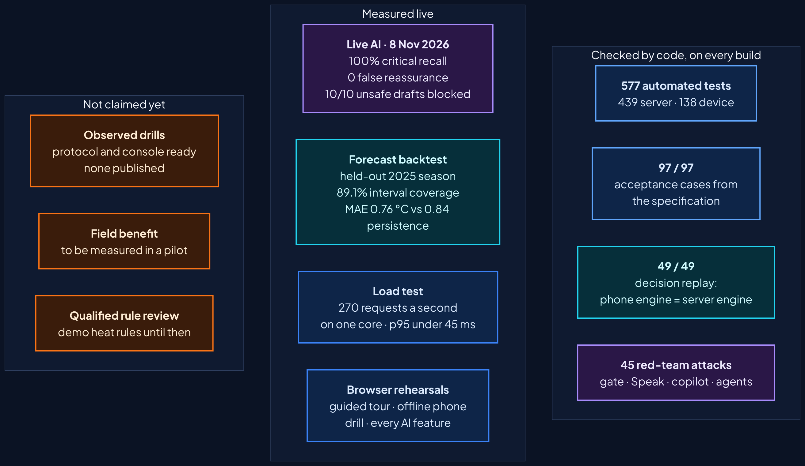

Source: [diagrams/src/10-evidence.mmd](diagrams/src/10-evidence.mmd)

## Invariants and the tests that hold them

A selection of the 639 release tests, by the rule they hold. The full list, tied to the 97 acceptance cases, is in
*Trust Centre → Release tests* and [TESTING.md](TESTING.md).

| Invariant | Release test (backend/tests) |
|---|---|
| Urgent words open the emergency card with no AI and no network | `test_emergency_words_open_the_card_without_ai_or_network`, `test_device_engine_needs_no_language_or_network_for_an_emergency` |
| An emergency outranks the midday window and stale data | `test_precedence_emergency_outranks_midday_and_stale_data` |
| A forecast is never a live observation; a harsher live reading tightens the plan | `test_forecast_is_never_a_live_observation`, `test_live_reading_overrides_a_milder_forecast_and_tightens_the_plan` |
| A modified, rolled-back or expired rule pack is refused | `test_modified_pack_is_rejected_with_a_safe_fallback`, `test_rolled_back_pack_version_is_rejected`, `test_pack_past_review_date_gives_assessment_unavailable` |
| The optimiser is re-checked independently; a change invalidates the plan | `test_fault_injection_is_caught_by_independent_revalidation`, `test_change_between_evaluation_and_activation_invalidates_the_plan` |
| No legal plan exists for work forced into the midday window | `test_work_forced_into_the_midday_window_has_no_legal_plan` |
| A dispute reopens, escalates and hides the disputer | `test_worker_dispute_reopens_escalates_and_hides_the_disputer` |
| Only someone outside the supervisor's line resolves a dispute, with a fresh check | `test_only_someone_outside_the_supervisors_line_can_resolve_a_dispute`, `test_hse_resolves_a_dispute_with_a_fresh_independent_check_and_the_worker_can_challenge_again` |
| The person who fixed it cannot be its independent check | `test_the_person_who_fixed_it_cannot_also_be_its_independent_check` |
| Employer roles cannot read clinical data; operational views carry no clinical fields | `test_employer_roles_cannot_read_clinical_endpoints`, `test_operational_views_carry_no_clinical_fields` |
| The employer sees only the visit window, never a missed appointment's reason | `test_each_booking_gets_its_own_future_slot_and_the_employer_sees_only_the_window`, `test_missed_appointment_reason_never_reaches_the_employer` |
| Withdrawal wins; a stale offline grant cannot restore a permission | `test_withdrawal_wins_ties_but_a_later_online_grant_counts`, `test_stale_offline_grant_cannot_restore_permission` |
| Small groups and their complements are suppressed; subtraction is blocked | `test_small_cell_and_its_complement_are_suppressed`, `test_overlapping_aggregates_that_isolate_a_small_group_are_blocked` |
| The audit log detects tampering | `test_audit_chain_verifies_and_detects_tampering` |
| Models never receive worker identity; real data never reaches a free-tier model | `test_models_never_receive_worker_identity`, `test_real_data_is_never_sent_to_a_free_tier_model` |
| No model name ever reaches the interface | `test_no_model_identifier_ever_reaches_the_interface` |
| People never read internal codes, including in the AI trace | `test_people_never_read_internal_codes` |
| Breaks follow the ISO 7243 / NIOSH limit for the job and can only add rest | `test_rest_agrees_with_the_acgih_screening_table`, `test_rest_never_decreases_when_work_gets_harder`, `test_rules_are_never_relaxed_for_productivity` |
| The simulator never rewrites the past and every plan shown is re-checked | `test_the_past_is_frozen_and_changes_apply_only_from_now`, `test_random_days_of_changes_always_stay_rechecked_valid` |
| A wearable shares words, never numbers, only by choice, and can never clear a worker | `test_shared_status_reaches_the_supervisor_as_words_never_numbers`, `test_no_number_and_no_clearing_status_can_cross_from_the_phone`, `test_wearable_status_needs_the_workers_own_consent` |
